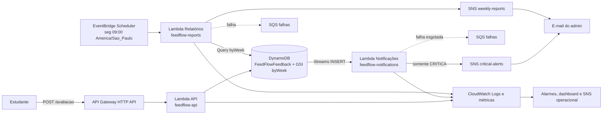

# FeedFlow

FeedFlow é o projeto da Fase 4 do FIAP Tech Challenge. A entrega cobre as Sprints 1 a 7, com API e persistência de avaliações, notificações, relatórios, integração contínua e implantação pela AWS CLI.

## Arquitetura da solução

### Modelo de cloud escolhido

**AWS, 100% serverless (FaaS + serviços gerenciados), região `us-east-2`.** Não há servidor para
provisionar, aplicar patch ou escalar: o custo é por uso (importante com créditos limitados) e o
desacoplamento por eventos garante a responsabilidade única de cada função.



### Componentes e responsabilidades

| Componente | Responsabilidade única | Por que foi escolhido |
|---|---|---|
| API Gateway HTTP API v2 | Expor `GET /health` e `POST /avaliacao` via HTTPS, com throttling (10 req/s, burst 20) | Mais barato e simples que REST API; só duas rotas |
| Lambda `feedflow-api` | Validar, classificar e gravar a avaliação | Sem estado; escala a zero |
| DynamoDB | Armazenar avaliações; GSI `byWeek` evita `Scan` no relatório | On-demand, sem servidor, Streams nativos |
| Lambda `feedflow-notifications` | Reagir a novas avaliações **críticas** e publicar o alerta | Acionada por evento, sem polling |
| SNS | Entregar e-mails (alertas, relatório, alarmes) | Assinatura de e-mail gerenciada |
| Lambda `feedflow-reports` | Agregar a semana anterior e publicar o relatório | Execução agendada, independente da API |
| EventBridge Scheduler | Disparar o relatório toda segunda, 09:00 | Suporta fuso horário e retry |
| SQS (filas de falhas) | Reter eventos que esgotaram os retries | Nada se perde em silêncio |
| CloudWatch | Logs, métricas, alarmes e dashboard | Nativo, sem agente |

### Documentação das funções

| Função | Gatilho | Entrada | Saída/efeito | Handler |
|---|---|---|---|---|
| `feedflow-api` | API Gateway | `{"descricao": string, "nota": 0..10}` | `201` com id/urgência; `400` entrada inválida; `500` falha de persistência | `QuarkusStreamHandler::handleRequest` |
| `feedflow-notifications` | DynamoDB Streams (`INSERT`) | Registro do stream | E-mail com **descrição, urgência e data de envio** (mais id, nota e data de geração do alerta), somente `CRITICA` | `CriticalNotificationHandler::handleRequest` |
| `feedflow-reports` | EventBridge Scheduler | `{"source":"feedflow.scheduler.weekly-report"}` | E-mail com **média, descrição, urgência e data de cada avaliação, quantidade por dia e por urgência** | `WeeklyReportHandler::handleRequest` |

Regra de urgência: nota 0–3 `CRITICA`, 4–6 `MEDIA`, 7–10 `BAIXA`. O PDF do desafio escreve
`POST /avaliação`; a rota implementada é `POST /avaliacao` (sem acento, por segurança em URLs).

### Controles verificados na AWS

- O Stream da tabela usa `NEW_IMAGE`. O mapeamento de notificações estava habilitado, com resposta parcial, divisão de lote em falha, 3 retentativas e destino SQS para falhas.
- O Scheduler do relatório estava habilitado para segundas-feiras às 09:00 em `America/Sao_Paulo`, com 2 retentativas, idade máxima de 1 hora e fila de falhas SQS.
- A HTTP API pública usa throttling de 10 requisições por segundo e burst de 20. As duas filas de falhas têm criptografia gerenciada pelo SQS e retenção de 14 dias.
- O PITR estava desabilitado na tabela da conta de avaliação.

O template principal descreve as permissões dos serviços.

## Deploy

O script `scripts/deploy-direct.sh` atualiza o código das três Lambdas com `aws lambda update-function-code` e cria ou atualiza `feedflow-dev-monitoring` a partir de `monitoring.yaml`. A stack de monitoramento é separada e o template prescinde da diretiva `Transform` do SAM, o que permite criá-la com `CreateStack`. A simulação IAM indicou negação para as operações de change set usadas pelo `sam deploy`. A implantação pela AWS CLI foi verificada com as operações diretas.

Antes de atualizar as funções, faça backup dos pacotes atuais com `aws lambda get-function` e confira o `CodeSha256` de cada função após a atualização. Para inspecionar o plano no Git Bash, use:

```bash
bash ./mvnw -B -ntp clean verify
export AWS_PROFILE=feedflow AWS_REGION=us-east-2
read -r -p 'E-mail de notificações: ' ADMIN_EMAIL
export ADMIN_EMAIL
bash ./scripts/deploy-direct.sh --dry-run
```

O modo `--dry-run` consulta os outputs, valida os ZIPs e imprime os comandos de alteração. Com as permissões aprovadas, execute o script sem `--dry-run` para aplicar o plano e aguardar o estado final das funções e da stack.

## Monitoramento

A stack `feedflow-dev-monitoring` está em `CREATE_COMPLETE`. Ela gerencia o tópico SNS `feedflow-dev-monitoring-ops-alarms` e o dashboard `feedflow-dev-monitoring-overview`, com cinco widgets de métricas. Os sete alarmes cobrem:

- Erros da Lambda da API.
- Duração p95 da API acima de 12 segundos.
- Erros da Lambda de notificações.
- Erros da Lambda de relatórios.
- Respostas 5xx do API Gateway.
- Fila de falhas das notificações com mensagens visíveis.
- Fila de falhas dos relatórios com mensagens visíveis.

A assinatura do tópico de alarmes estava em `PendingConfirmation` na última verificação. Para receber os alarmes, confirme a assinatura pelo e-mail enviado pelo SNS.

## Limitações

As três Lambdas e a stack de monitoramento foram implantadas pela AWS CLI em `us-east-2`. O workflow `.github/workflows/deploy.yml` foi preparado para o Environment `feedflow-dev`. A chamada real `iam:CreateOpenIDConnectProvider` retornou `AccessDenied` por uma SCP da organização. O deploy pelo GitHub Actions depende da liberação do provedor, da criação da role e da configuração da variável `AWS_DEPLOY_ROLE_ARN`. O projeto só adotará chaves de acesso de longa duração com autorização da administração. Para vincular o repositório de entrega ao ambiente AWS, consulte os [ajustes de OIDC para o FeedFlow-FIAP](docs/sprint7-oidc.md#ajustes-para-o-feedflow-fiap).

O código das Lambdas foi atualizado fora do CloudFormation. Um futuro `sam deploy` da stack `feedflow-dev` pode sobrescrevê-lo com os artefatos daquele deploy.

### Validação da entrega

| Item | Evidência verificada |
| --- | --- |
| `template.yaml` | `sam validate --template-file template.yaml --profile feedflow --region us-east-2 --lint` |
| `monitoring.yaml` | `aws cloudformation validate-template --template-body file://monitoring.yaml --profile feedflow --region us-east-2` |
| `scripts/deploy-direct.sh` | `bash -n scripts/deploy-direct.sh` e dry-run com os outputs de `feedflow-dev` e os três ZIPs. |
| `.github/workflows/deploy.yml` | Arquivo remoto conferido com a cópia local. O workflow de deploy manual ainda depende da configuração AWS e da revisão do PR para a branch padrão. |
| CI da revisão `314660d` no repositório original | [Build and test (Java 17)](https://github.com/ygorsmedeiros/FeedFlow/actions/runs/43981155889/job/133697658950). O build executou 46 testes da API, 12 de notificações e 14 de relatórios. A etapa com DynamoDB Local repetiu os 46 testes da API e executou mais 7 testes de integração, todos aprovados. |
| API ativa | `200/UP` no health, notas 2 e 9 com `201` e itens persistidos como `CRITICA` e `BAIXA`. A nota 11 retornou `400`. |
| Relatório e SNS | Os logs registraram publicação do alerta crítico e do relatório da semana de 09 a 15/11. A consulta inicial encontrou zero avaliações. A execução com a amostra sintética autorizada registrou três avaliações. O índice confirmou os dados da amostra e as assinaturas SNS ativas estavam confirmadas. |
| Monitoramento | Stack em `CREATE_COMPLETE`, sete alarmes, dashboard com cinco widgets e tópico SNS de operação. |

Veja o [roteiro de gravação](docs/demo-script.md) para os comandos, o período da Lambda e o cálculo reproduzível no DynamoDB Local.

## Vídeo de demonstração

Vídeo: LINK_A_DEFINIR. O link será preenchido após a gravação e o upload como vídeo não listado.

## Escopo implementado

- `GET /health`, com resposta HTTP 200 e o JSON `{"status":"UP","application":"FeedFlow"}`;
- validação e classificação do contrato oficial `POST /avaliacao`;
- modelo de domínio com ID UUID, urgência e timestamp UTC gerados no servidor;
- persistência com AWS SDK for Java 2.x, escrita condicional e consulta por ID;
- consulta semanal paginada por `Query` no GSI `byWeek`, sem `Scan`;
- DynamoDB Local reproduzível com Docker Compose, volume persistente e Streams `NEW_IMAGE`;
- empacotamento JVM da API para AWS Lambda;
- Lambda Java 17 que consome `INSERT` do DynamoDB Streams e publica somente avaliações `CRITICA` no SNS;
- resposta parcial por lote, retries limitados e destino SQS para falhas esgotadas;
- Lambda Java 17 que consulta a semana anterior, agrega métricas e publica um relatório completo em tópico SNS exclusivo;
- EventBridge Scheduler às segundas-feiras, 09:00 em `America/Sao_Paulo`, com retries e destino SQS;
- template AWS SAM com HTTP API v2, três Lambdas Java 17, DynamoDB, SNS, SQS, Scheduler, log groups, IAM mínimo, alarmes CloudWatch e dashboard;
- workflow manual de deploy preparado para GitHub Actions via OIDC (`.github/workflows/deploy.yml`), com autenticação pendente;
- scripts PowerShell de build, validação, deploy manual, consulta e remoção da stack;
- testes automatizados unitários, HTTP e de integração real com DynamoDB Local;
- validação explícita do limite SNS de 256 KiB em UTF-8 antes da publicação do relatório.

A aplicação usa API pública em `us-east-2` e recebe avaliações sem frontend. Uma avaliação válida retorna HTTP 201 somente depois que o DynamoDB confirma a gravação.

## Estrutura

```text
FeedFlow/
├── pom.xml
├── mvnw
├── mvnw.cmd
├── .mvn/wrapper/
├── template.yaml
├── compose.yaml
├── docker/dynamodb/create-table.json
├── docs/sprint4-infrastructure.md
├── docs/sprint7-cd-manual.md
├── infrastructure/oidc/github-actions-oidc.yaml
├── scripts/
│   ├── build-and-test.ps1
│   ├── validate-sam.ps1
│   ├── deploy-aws.ps1
│   ├── preview-oidc-change-set.ps1
│   ├── validate-aws-deployment.ps1
│   ├── show-aws-stack.ps1
│   ├── remove-aws-stack.ps1
│   ├── initialize-dynamodb-local.ps1
│   └── query-dynamodb-local.ps1
├── feedflow-api/
│   ├── pom.xml
│   └── src/
│       ├── main/java/br/com/feedflow/
│       │   ├── api/
│       │   └── avaliacao/{api,application,domain,persistence}/
│       └── test/java/br/com/feedflow/
├── feedflow-notifications/
│   ├── pom.xml
│   └── src/
│       ├── assembly/lambda.xml
│       ├── main/java/br/com/feedflow/notifications/{domain,handler,processing,publishing}/
│       └── test/java/br/com/feedflow/notifications/{handler,publishing}/
└── feedflow-reports/
    ├── pom.xml
    └── src/
        ├── assembly/lambda.xml
        ├── main/java/br/com/feedflow/reports/{aggregation,application,domain,formatting,handler,period,publishing,repository}/
        └── test/java/br/com/feedflow/reports/
```

## Tecnologias e versões

- Java 17;
- Maven 3.9.14 pelo Maven Wrapper;
- Quarkus 3.33.4.1 LTS;
- Quarkus REST com Jackson;
- adaptador Quarkus AWS Lambda HTTP para API Gateway HTTP API v2;
- AWS SDK for Java 2.54.16;
- AWS Lambda Java Core 1.3.0 e Events 3.16.1;
- DynamoDB Local 3.3.2 e AWS CLI 2.36.44 em containers;
- AWS CLI 2.39.3 e AWS SAM CLI 1.171.0 para a infraestrutura AWS;
- JUnit 5 e REST Assured.

O build exige JDK 17 e Maven 3.9.x por meio do Maven Enforcer. A compilação usa `--release 17`.

## Requisitos

- JDK 17 instalado;
- Docker Desktop com Docker Compose para persistência e testes de integração;
- AWS CLI e AWS SAM CLI para validar e, somente com autorização, operar a infraestrutura;
- PowerShell no Windows ou um shell compatível com POSIX em Linux/macOS;
- acesso à internet na primeira execução do Wrapper para baixar o Maven e as dependências.

No ambiente Windows usado no projeto, o JDK 17 está em `E:\Program Files\Java\jdk-17`. Para configurá-lo apenas na sessão atual do PowerShell:

```powershell
$env:JAVA_HOME = 'E:\Program Files\Java\jdk-17'
$env:Path = "$env:JAVA_HOME\bin;$env:Path"
java -version
```

## Build e testes

No Windows:

```powershell
.\mvnw.cmd clean verify
```

Em Linux ou macOS:

```bash
./mvnw clean verify
```

O comando executa os testes da API e compila os três módulos.

Para executar também os testes reais contra o DynamoDB Local:

```powershell
.\scripts\initialize-dynamodb-local.ps1
.\mvnw.cmd -pl feedflow-api -Pdynamodb-local verify
```

O perfil `dynamodb-local` executa os testes `*IT`. Sem esse perfil, o build padrão permanece independente do Docker e usa mocks somente nos testes HTTP.

## Execução local

Inicie e configure o banco local. O script é idempotente: cria a tabela apenas se ela ainda não existir.

```powershell
.\scripts\initialize-dynamodb-local.ps1
```

Inicie somente o módulo da API:

```powershell
.\mvnw.cmd -pl feedflow-api quarkus:dev
```

Em outro terminal, consulte o endpoint:

```powershell
Invoke-RestMethod http://localhost:8080/health | ConvertTo-Json -Compress
```

Resposta esperada:

```json
{"status":"UP","application":"FeedFlow"}
```

O perfil de desenvolvimento usa `http://localhost:8000` com credenciais fictícias. Elas são válidas exclusivamente para o DynamoDB Local e não concedem acesso à AWS.

## Contrato de avaliações

A rota oficial e exclusiva é `POST /avaliacao`, com `Content-Type: application/json`. A rota Unicode `/avaliação` e o proxy `POST /{proxy+}` foram removidos na Sprint 5 por decisão do Tech Lead; o teste HTTP confirma que o caminho removido retorna 404.

Regras aplicadas:

- `nota` é obrigatória, deve ser um número inteiro JSON e estar entre 0 e 10;
- notas de 0 a 3 recebem urgência `CRITICA` e exigem uma `descricao` textual não vazia;
- notas de 4 a 6 recebem urgência `MEDIA`;
- notas de 7 a 10 recebem urgência `BAIXA`;
- `descricao` tem no máximo 1.000 caracteres;
- para notas não críticas, descrição ausente, nula ou em branco é normalizada para `null`;
- uma descrição não vazia é preservada como recebida, sem remoção de espaços.

Exemplo válido de avaliação crítica:

```json
{
  "nota": 2,
  "descricao": "O áudio da aula ficou interrompendo."
}
```

Exemplo válido sem comentário:

```json
{
  "nota": 8
}
```

Depois da gravação confirmada, o exemplo sem comentário retorna:

```http
HTTP/1.1 201 Created
Content-Type: application/json
```

```json
{
  "id": "c0d271b2-8f27-4c47-9c88-cde15fb3fb2d",
  "nota": 8,
  "urgencia": "BAIXA",
  "descricao": null,
  "criadoEm": "2026-11-02T15:46:41.241201300Z",
  "mensagem": "Avaliação registrada sem comentário."
}
```

Exemplo inválido:

```json
{
  "nota": 3,
  "descricao": "   "
}
```

Resposta:

```http
HTTP/1.1 400 Bad Request
Content-Type: application/json
```

```json
{
  "codigo": "AVALIACAO_INVALIDA",
  "mensagem": "A descrição é obrigatória para avaliações críticas."
}
```

Falhas do DynamoDB não retornam falso sucesso. A API responde HTTP 500 sem endpoint, credenciais ou stack trace:

```json
{
  "codigo": "ERRO_PERSISTENCIA",
  "mensagem": "Não foi possível registrar a avaliação."
}
```

O contrato de sucesso retorna `id`, `nota`, `urgencia`, `descricao`, `criadoEm` e `mensagem`. Para avaliações não críticas sem descrição, a mensagem é `"Avaliação registrada sem comentário."`, mantendo `descricao: null` no domínio e o atributo ausente no DynamoDB.

Exemplo de chamada no PowerShell:

```powershell
$body = @{ nota = 8 } | ConvertTo-Json
Invoke-RestMethod -Method Post -Uri 'http://localhost:8080/avaliacao' -ContentType 'application/json' -Body $body
```

## Modelo DynamoDB

Tabela padrão: `FeedFlowFeedback`. O nome é configurável por `FEEDFLOW_DYNAMODB_TABLE_NAME`.

| Atributo | Tipo | Uso |
|---|---|---|
| `id` | String UUID | Partition key da tabela |
| `descricao` | String opcional | Omitido quando a descrição é nula |
| `nota` | Number | Nota de 0 a 10 |
| `urgencia` | String | `CRITICA`, `MEDIA` ou `BAIXA` |
| `createdAt` | String UTC | ISO 8601 com nove dígitos fracionários para ordenação estável |
| `weekKey` | String | `SEMANA#AAAA-MM-DD`, usando a segunda-feira em `America/Sao_Paulo` |

O GSI `byWeek` usa `weekKey` como partition key, `createdAt` como sort key e projeção `ALL`. A consulta semanal percorre todas as páginas do `Query`; nenhum `Scan` é usado. A tabela local usa cobrança lógica `PAY_PER_REQUEST` e Streams com `NEW_IMAGE`.

A escrita usa a condição `attribute_not_exists(id)`, evitando que uma colisão de UUID sobrescreva silenciosamente uma avaliação existente.

Configurações:

| Variável | Padrão | Finalidade |
|---|---|---|
| `FEEDFLOW_DYNAMODB_TABLE_NAME` | `FeedFlowFeedback` | Nome da tabela |
| `AWS_REGION` | `us-east-2` | Região do cliente (Ohio) |
| `FEEDFLOW_DYNAMODB_QUERY_PAGE_SIZE` | `100` | Limite por página do Query |
| `FEEDFLOW_DYNAMODB_ENDPOINT` | `http://localhost:8000` somente em dev/test | Endpoint local explícito |

Sem endpoint override, o cliente usa a cadeia padrão de credenciais do AWS SDK. Nenhuma chave real é armazenada no projeto.

Na futura configuração AWS da Sprint 4, a Lambda não deverá receber `FEEDFLOW_DYNAMODB_ENDPOINT`; ela usará sua execution role e `FEEDFLOW_DYNAMODB_TABLE_NAME`. O IAM mínimo da API deverá permitir `PutItem` e `GetItem` na tabela e `Query` no ARN do índice `byWeek`, sem permissão de `Scan`. O template SAM também deverá declarar Streams `NEW_IMAGE`, criptografia em repouso e a decisão de backup/retenção. A escolha entre chave gerenciada pela AWS ou KMS própria, proteção contra exclusão e prazo de retenção permanece pendente de decisão do Tech Lead.

Consulta diagnóstica do GSI:

```powershell
.\scripts\query-dynamodb-local.ps1 `
    -WeekKey 'SEMANA#2026-11-02' `
    -InicioUtc '2026-11-02T03:00:00.000000000Z' `
    -FimUtc '2026-11-09T02:59:59.999999999Z'
```

O volume nomeado `feedflow_feedflow-dynamodb-data` preserva os registros após reiniciar a API ou recriar o container. `docker compose down` preserva o volume; `docker compose down -v` o remove e deve ser usado somente quando a exclusão dos dados locais for intencional.

## Integração com AWS Lambda

A dependência `quarkus-amazon-lambda-http` foi escolhida porque a arquitetura aprovada usa API Gateway HTTP API. Ela recebe eventos no formato API Gateway v2, encaminha as requisições ao Quarkus REST e gera o pacote JVM da função. A alternativa `quarkus-amazon-lambda-rest` atende ao produto API Gateway REST API v1 e, portanto, não corresponde à integração aprovada.

Gere os artefatos com:

```powershell
.\mvnw.cmd -pl feedflow-api clean package
```

Os principais arquivos ficam em `feedflow-api/target/`:

- `function.zip`: pacote de implantação da Lambda;
- `sam.jvm.yaml`: template auxiliar gerado pelo Quarkus;
- `sam.native.yaml`: template auxiliar para build nativo, fora do escopo atual.

O handler JVM da integração é `io.quarkus.amazon.lambda.runtime.QuarkusStreamHandler::handleRequest`. A infraestrutura versionada está no `template.yaml`; o empacotamento Maven e a validação SAM não criam recursos AWS.

A Lambda de notificações gera o JAR sombreado `feedflow-notifications/target/feedflow-notifications-1.0.0-SNAPSHOT.jar` e o pacote de implantação `feedflow-notifications/target/function.zip`. O ZIP segue o layout Java do Lambda, com o JAR em `lib/`, e é o artefato referenciado pelo SAM. O handler é `br.com.feedflow.notifications.handler.CriticalNotificationHandler::handleRequest`; o pacote contém a aplicação, AWS Lambda Java Events, AWS SDK v2 para SNS e o cliente HTTP necessários em runtime.

A Lambda de relatórios gera `feedflow-reports/target/function.zip`, também com JAR sombreado em `lib/`. O handler é `br.com.feedflow.reports.handler.WeeklyReportHandler::handleRequest`; o pacote inclui AWS SDK v2 para DynamoDB e SNS. As variáveis `FEEDFLOW_DYNAMODB_TABLE_NAME` e `FEEDFLOW_REPORT_TOPIC_ARN` são preenchidas pelo SAM.

O pacote é compilado como bytecode Java 17. O template auxiliar `sam.jvm.yaml` embutido no Quarkus 3.33 usa `Runtime: java21` por padrão; ele não é a infraestrutura aprovada do FeedFlow. O `template.yaml` versionado declara explicitamente `Runtime: java17` e usa o mesmo `function.zip`.

## Infraestrutura AWS SAM

O template gerencia na stack `feedflow-dev`:

- API Gateway HTTP API v2 no stage `$default`;
- Lambda API Java 17, `x86_64`, 512 MB e timeout de 15 segundos;
- Lambda de notificações Java 17, `x86_64`, 256 MB e timeout de 20 segundos;
- Lambda de relatórios Java 17, `x86_64`, 512 MB e timeout de 60 segundos;
- tabela `FeedFlowFeedback` on-demand, GSI `byWeek` e Streams `NEW_IMAGE`;
- tópico SNS `feedflow-dev-critical-alerts`, sem assinatura criada automaticamente;
- tópico SNS separado `feedflow-dev-weekly-reports`, também sem assinatura automática;
- fila SQS criptografada `feedflow-dev-notifications-failures`, com retenção de 14 dias para falhas esgotadas;
- Event Source Mapping com lotes de até 10, resposta parcial, três retries e idade máxima de uma hora;
- EventBridge Scheduler semanal, segunda-feira às 09:00 no fuso `America/Sao_Paulo`;
- execution roles separadas para API, notificações, relatórios e Scheduler, com permissões restritas aos recursos necessários;
- CloudWatch Log Groups separados, com retenção de 14 dias.

O API Gateway expõe somente `GET /health` e `POST /avaliacao`. Não existe rota proxy ou output Unicode. CORS não foi habilitado porque não existe frontend nesta sprint.

## Lambda de notificações críticas

O fluxo previsto é `DynamoDB Streams → Lambda de notificações → SNS`. A função recebe os registros do stream, ignora eventos `MODIFY`/`REMOVE` e avaliações `MEDIA`/`BAIXA`, valida o `NewImage` e publica no tópico somente quando `urgencia` é `CRITICA`. A mensagem contém ID, nota, urgência, descrição, data de criação e data de geração do alerta, ambas em UTC.

Registros com campos ausentes ou inválidos são considerados falhas permanentes: são registrados sem o conteúdo da avaliação e confirmados como processados para não bloquear o shard. Falhas técnicas, incluindo erro de publicação SNS, são retornadas em `batchItemFailures` pelo `sequenceNumber`; os demais registros do lote continuam sendo processados.

A entrega é **at least once**. O Event Source Mapping pode reenviar registros após erro e, ao usar resposta parcial em Streams, o checkpoint volta ao menor identificador com falha; registros posteriores podem ser processados novamente. A função não mantém deduplicação durável, portanto um retry — inclusive após publicação SNS bem-sucedida cuja resposta se perdeu — pode gerar alerta duplicado. Depois de três retries ou uma hora, o Lambda envia metadados da invocação descartada à fila SQS. Essa fila não preserva necessariamente o `NewImage` completo para replay após a expiração do Stream.

O tópico não possui assinatura no template. Depois do deploy autorizado, o Tech Lead deverá fornecer um endereço real, criar e confirmar a assinatura de e-mail e executar o teste ponta a ponta. Uma assinatura pendente não recebe notificações.

## Lambda de relatório semanal

O fluxo previsto é `EventBridge Scheduler → Lambda de relatórios → DynamoDB byWeek → SNS Weekly Reports`. O Scheduler envia `{"source":"feedflow.scheduler.weekly-report"}`; como o payload não inventa um campo dinâmico `time`, o handler usa o relógio da invocação e calcula a semana anterior completa em `America/Sao_Paulo`.

O Scheduler possui retry de entrega por até uma hora e uma fila SQS de falhas. Como a chamada da Lambda é assíncrona, existe também uma configuração independente de dois retries da execução Lambda, idade máxima de uma hora e destino para a mesma fila. A entrega é **at least once**: uma falha após o SNS aceitar a mensagem pode gerar relatório duplicado no retry.

Antes de publicar, o relatório é medido em UTF-8. Mensagens maiores que 262.144 bytes falham explicitamente e não são truncadas. Uma evolução possível é armazenar o relatório completo no S3 e publicar somente um resumo/link, mas nenhum bucket adicional foi introduzido nesta sprint. Consulte [as decisões da Sprint 6](docs/sprint6-reports.md).

Build e validação local:

```powershell
.\scripts\build-and-test.ps1
.\scripts\validate-sam.ps1
```

Testes com DynamoDB Local:

```powershell
.\scripts\build-and-test.ps1 -IncludeDynamoDbLocalTests
```

O procedimento original da Sprint 7 usava change sets. Os comandos abaixo ficam como referência histórica. Para o procedimento da entrega, consulte [Deploy](#deploy).

Preview do change set:

```powershell
.\scripts\deploy-aws.ps1 -Authorization PREVIEW -PreviewOnly
```

Após revisão e aprovação humana do preview:

```powershell
.\scripts\deploy-aws.ps1 -Authorization DEPLOY -ChangeSetPreviewApproved
```

O script usa o perfil `feedflow`, a região `us-east-2` (Ohio) e a stack `feedflow-dev`. O deploy normal preserva `--confirm-changeset`; o modo preview usa `--no-execute-changeset`. Consulte [o processo de CI/CD da Sprint 7](docs/sprint7-cd-manual.md), [a preparação OIDC](docs/sprint7-oidc.md), [a documentação da infraestrutura](docs/sprint4-infrastructure.md) e [as decisões da Lambda de notificações](docs/sprint5-notifications.md).

## Próximos passos

O Tech Lead deverá revisar o IAM das Lambdas, os limites de retry/idade, as filas de falhas, a ausência deliberada de deduplicação durável, o limite de 256 KiB do relatório e a estratégia para criar assinaturas SNS com endereços reais. As evidências do deploy e da validação em AWS estão descritas acima. O Compose e as credenciais fictícias existem exclusivamente para desenvolvimento local.
